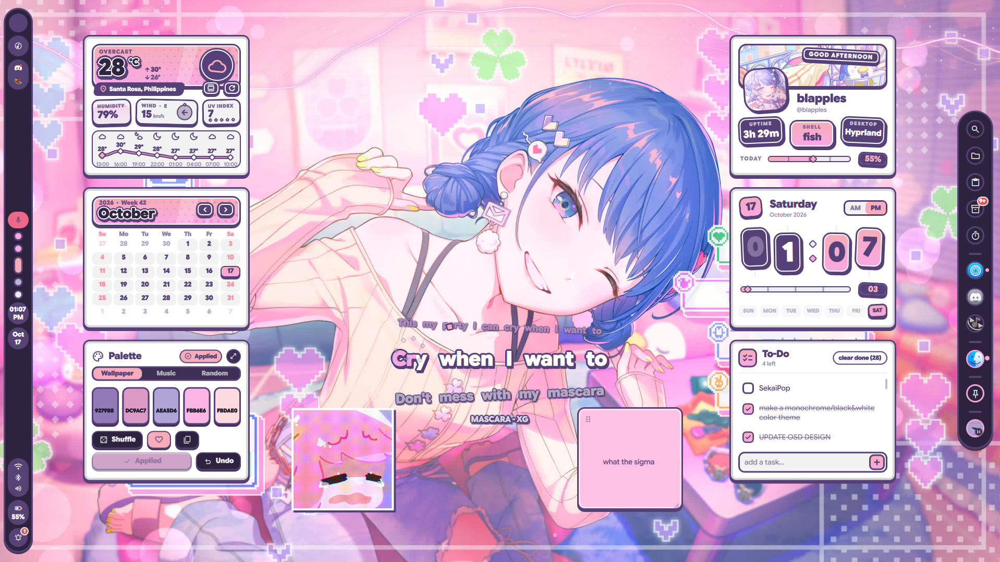
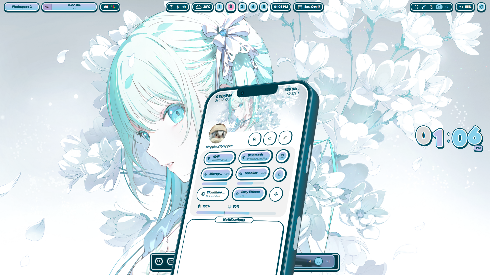
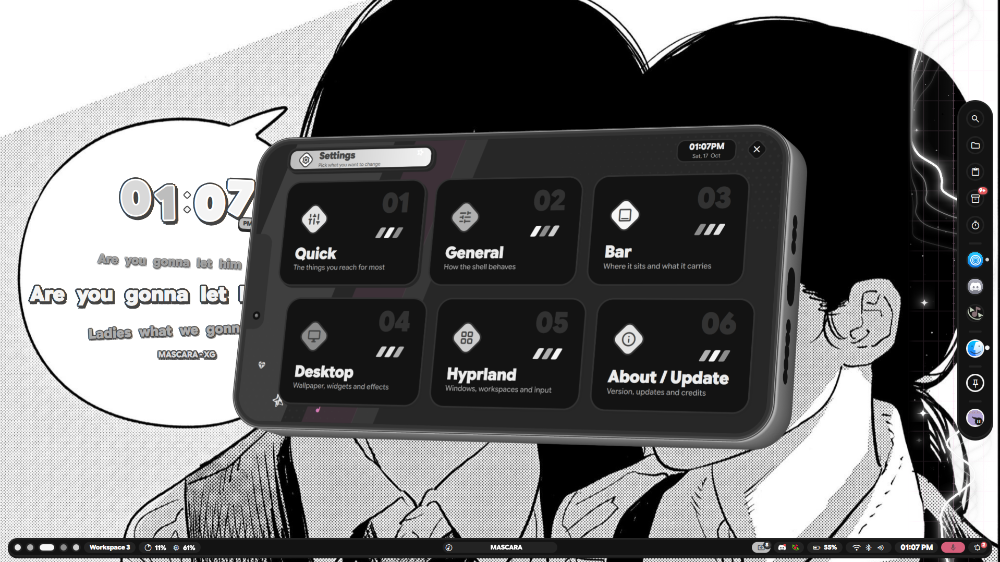
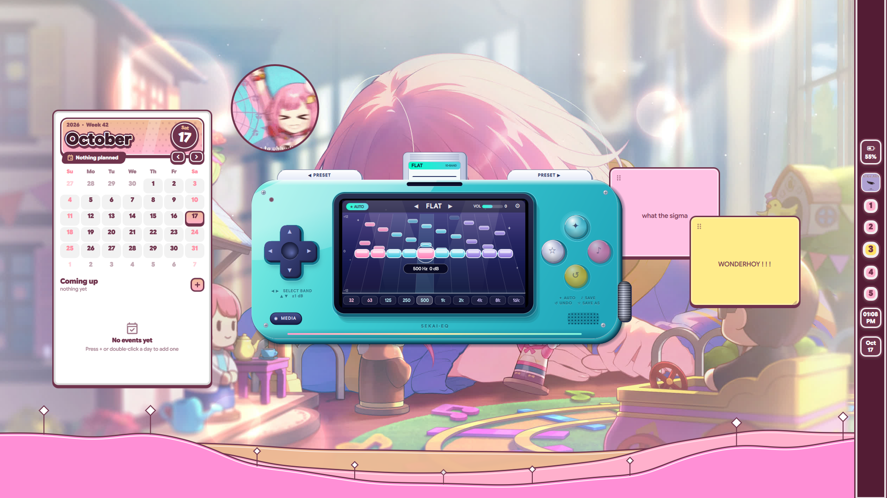
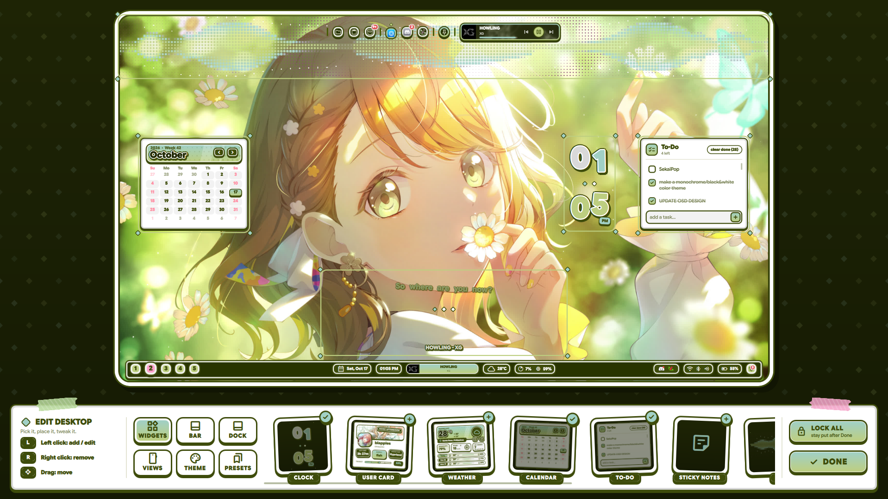

<div align="center">

# SekaiPop

**A Quickshell + Hyprland desktop shell where your whole desktop is built out of chunky, outlined, sticker-and-keycap blocks, and your control center is a phone.**

Arch / CachyOS / EndeavourOS · Hyprland 0.55+ (Lua config) · Quickshell · Qt 6



</div>

---

## Showcase

### Desktop widgets
Clock, weather card, calendar, to-do, palette tool, user card, sticky notes, lyrics and custom images. Every widget is draggable, resizable and optional.


### Quick Panel: the control center is a phone
Wi-Fi, Bluetooth, mic, speaker, brightness, night light, easy effects and notifications sit on a 2.5D phone that bounces up from the bottom of the screen. New notifications make the phone rise just far enough to show them.



### Settings: flip the phone sideways
Settings opens by rotating the Quick Panel phone into landscape. Six pages: Quick, General, Bar, Desktop, Hyprland, About / Update. Shown here in the **Monochrome** theme.



### Sekai Pad: the equalizer is a handheld console
A 10-band EQ (EasyEffects) drawn as a handheld game console, with a D-pad for band select, face buttons for save / undo / auto, and preset cartridges you swap in at the top.



### Edit Desktop: rearrange everything like a scrapbook
Press `Super + Shift + E`. Drag widgets, rearrange the bar, switch the dock's tools on and off, pick themes, save and wear presets. Left click adds / edits, right click removes, drag moves.



---

## What makes SekaiPop different

Most Quickshell setups pick one look (Material cards, a glassy dock, a sidebar) and theme it. SekaiPop is built the other way around: **one design language, applied to everything, with a few ideas you won't find elsewhere.**

### 1. One block, everywhere
Every pill, key, card, popup and lockscreen element is the same object: a **thick outline, a thin white ring, a fill, and a hard drop shadow**, like a sticker or a keycap that sinks when you press it. Buttons, bar pills, the dock, the calendar, the lockscreen's password field all share it, so nothing looks bolted on.

### 2. The shell is a phone
The control center, settings and app launcher are not panels, they are **phones**:
- **Quick Panel phone** (2.5D, portrait) with live toggles, sliders, a volume mixer, Wi-Fi / Bluetooth popups and a notification area.
- **Settings phone** is the same phone **rotating into landscape**, with its own 2.5D buttons.
- **Launcher phone** is a home grid of built-ins and pinned apps plus an Apps drawer with search.
- Things pop up when they turn on and get swallowed when they turn off, instead of fading.

### 3. Sekai Pad, an equalizer designed as hardware
Not a slider panel: a handheld console with a D-pad, face buttons, a screen showing the live curve, and **preset cartridges** you slot in.

### 4. Edit Desktop, a layout editor made of the same blocks
A full-screen edit mode with tabs for **Widgets, Bar, Dock, Views, Theme and Presets**. You see exactly what you are changing, in place.

### 5. Presets that don't break when the shell grows
Save your whole desktop as a preset. Presets saved before a widget existed **don't suddenly drag that new widget in** when you wear them, and the lockscreen style, folder paths and other machine-specific choices are left alone.

### 6. Themes with personality
Six themes from the character units (Virtual Singer, Leo/need, MORE MORE JUMP!, Vivid BAD SQUAD, Wonderlands×Showtime, Nightcord at 25:00), a **Monochrome** theme, **Wallpaper (matugen)**, and a **Custom palette**, each in Light, Dark and Darker. The theme reaches window borders, GTK / Qt / KDE colours, the terminal and a **Vencord (Discord) theme** that follows whatever you pick.

### 7. Shader wallpaper transitions in your theme's colours
Ring, Iris, Star (it spins), Blocks, Flash and Fade, plus **Random**. The bands cover the whole desktop and then reveal the new wallpaper. Colours follow the active theme. The same transition plays into and out of the lockscreen.

### 8. Two lockscreens
**Gacha** and **Calendar** (a poster-style lockscreen: three frames cut out of your wallpaper by an edge / colour detector, the clock as four keycaps, a month card, Restart / Shut down keys that need a second press). Hold `Ctrl` and Enter becomes **Sleep**. While locked, the desktop actually **sleeps**: widgets are freed, cava and video wallpapers stop, and everything wakes up one by one on unlock.

### 9. A dock with real tools
Search, Files (Music / Pictures / Videos / Documents / Trash, video thumbnails, sort and filter), Clipboard, Timer, a media card with seeking, and the **Shelf**: a drag-and-drop tray whose items turn into polaroids, vinyls, books, folders and notes held with tape.

### 10. Music that feels alive
Bar media pill with a live wave, a **visualizer** widget (cava), and a **lyrics** widget that asks several providers (LyricsPlus, NetEase, LRCLIB, QQ Music, Kugou), picks the best one per song, supports **word-by-word** highlighting and has a source picker.

### 11. Discord voice built in
A bar pill and popup for Discord voice (who's in the call, who's speaking, mute, deafen) through a small Vencord companion plugin. This part is optional and needs the official Discord client patched with the standalone Vencord installer, plus `git`, `node` and `pnpm`; run `pjsekai/scripts/discordVoice/vencord-companion/install.sh` to add the plugin.

### 12. Configure it without touching config files
- **Displays**: drag screens on a to-scale layout, snap them together, set resolution, scale and refresh rate; saved to `monitors.lua` in nwg-displays' format.
- **Keyboard layouts** with a bar indicator and switcher, set up in Settings.
- **Cheatsheet** (`Super + /`) that builds itself from your Hyprland bind descriptions, including your own binds in `custom/keybinds.lua`.
- Night light with editable intensity, gamma / brightness OSD, and a reload popup that shows shell errors.

### 13. Everything else you expect from a full desktop
On-screen display, polkit prompt, notifications, screen snip (region, OCR to clipboard, Google Lens, screen record, colour picker), Game Mode, Focus Mode, a task-switching Overview, an on-screen keyboard, a welcome tour, and bar / dock on **any edge** in four styles (Float, Straight, Transparent, Capsule).

### 14. An installer that starts from a bare system
`./install.sh` takes a minimal Hyprland install and gives you the complete desktop: packages, fonts, services, groups, the shell, and a ready Hyprland config, with backups and a one-command restore.

---

## Requirements

### System
| Need | Notes |
|---|---|
| **Arch-based distro** (Arch, CachyOS, EndeavourOS) | The installer uses `pacman` and the AUR |
| **Hyprland 0.55+** | The config is **Lua** (`hyprland.lua`); older versions can't read it |
| **Quickshell** | `quickshell` or `quickshell-git` |
| **Qt 6.7+** | Shaders ship built for Qt 6.12; on older Qt the installer rebuilds them once (needs `qt6-shadertools`) |
| **A normal user with `sudo`** | Don't run the installer as root |
| **An AUR helper** (`yay` or `paru`) | The installer can build `yay-bin` for you if you have none |

GPU drivers are **never** touched. Install your own (especially NVIDIA) before you start.

### Core packages (the shell can't start without these)
`hyprland` `quickshell` `qt6-base` `qt6-declarative` `qt6-multimedia-ffmpeg` `qt6-svg` `qt6-imageformats` `qt6-wayland` `qt6-shadertools` `dbus` `polkit` `mesa` `pipewire` `wireplumber` `pipewire-pulse` `libpulse` `networkmanager` `bluez` `bluez-utils` `upower` `power-profiles-daemon` `libnotify` `wl-clipboard` `jq` `curl` `git` `xdg-utils` `xdg-user-dirs` `fontconfig` `python` `python-numpy` `ttf-material-symbols-variable`

### Feature packages
| For | Packages |
|---|---|
| Themes | `matugen` `adw-gtk-theme` `dconf` `glib2` `xorg-xrdb` |
| Music | `cava` `easyeffects` |
| Screenshots, OCR, recording | `grim` `slurp` `swappy` `tesseract` `tesseract-data-eng` `imagemagick` `wf-recorder` `ffmpeg` `hyprpicker` |
| Clipboard, emoji, typing | `cliphist` `wtype` |
| Night light, brightness | `hyprsunset` `brightnessctl` `ddcutil` |
| Dialogs, terminal | `zenity` `kitty` |
| Wi-Fi / Bluetooth "Advanced" buttons | `plasma-nm` `kde-cli-tools` `blueman` |
| Sounds, updates | `libcanberra` `sound-theme-freedesktop` `pacman-contrib` |
| Media keys | `playerctl` |

### Desktop layer (skip with `--no-desktop-layer` if you already have a desktop)
`xorg-xwayland` `xdg-desktop-portal` `xdg-desktop-portal-hyprland` `xdg-desktop-portal-gtk` `gvfs` `adwaita-icon-theme` `noto-fonts` `noto-fonts-cjk` `noto-fonts-emoji` `ttf-jetbrains-mono-nerd` `gnome-keyring` `libsecret` `pipewire-alsa`, plus a file manager (Dolphin on KDE, Thunar otherwise) and `qt6ct` where nothing else themes Qt.

### Optional (`--with-optional`)
`python-aubio` `songrec` (song recognition), `mpvpaper` (video wallpapers), `nwg-displays`, `hypridle`, `nodejs` `pnpm` (Vencord plugin build), `cloudflare-warp-bin`

### Font
**Google Sans Flex** (the installer fetches it into `~/.local/share/fonts`) and **Material Symbols Rounded** for icons.

### Services the installer enables
`NetworkManager`, `bluetooth`, `upower`, `power-profiles-daemon`, and the PipeWire user services (`pipewire`, `pipewire-pulse`, `wireplumber`). You are also added to the `video` group.

---

## Installation

### 1. Get it
```bash
git clone https://github.com/<your-username>/<your-repo>.git
cd <your-repo>
chmod +x install.sh install-deps.sh check-deps.sh
```

The repo layout:
```
install.sh        install-deps.sh        check-deps.sh
hypr/             the preconfigured Hyprland (Lua) config
pjsekai/          the shell itself (version in pjsekai/VERSION)
```

### 2. Look before you leap
```bash
./install.sh --dry-run      # prints everything it would do, changes nothing
```

### 3. Install
```bash
./install.sh
```

This runs three jobs:
1. **Dependencies**: packages (repos + AUR), Google Sans Flex, services, groups.
2. **The shell**: copied to `~/.config/quickshell/pjsekai` (an older copy is kept as `.bak-<time>`).
3. **Hyprland**: a ready Lua config in `~/.config/hypr` (keybinds, rules, autostart, idle lock) and a `monitors.lua` generated for the screens connected right now (inside a running Hyprland it picks the highest refresh rate your screen offers at its preferred size).

### 4. Start it
Log out and back in, choosing the plain **Hyprland** session (**not** "uwsm"). The shell starts by itself. Inside an already running Hyprland the installer offers to reload and start it for you.

### 5. Check everything
```bash
./check-deps.sh
```

### Installer options
| Option | What it does |
|---|---|
| `--dry-run` | Show everything, change nothing |
| `--yes` | No questions |
| `--hypr full` | Install the preconfigured Hyprland config (default on a new setup) |
| `--hypr merge` | **Keep your config**, only add a small `pjsekai_session` file |
| `--hypr skip` | Don't touch Hyprland at all |
| `--no-deps` | Only copy files, install no packages |
| `--rice DIR` | Install a different copy of the `pjsekai` folder |
| `--restore` | Put back the Hyprland config backed up by the last run |
| `-- <options>` | Pass options on to `install-deps.sh` |

`install-deps.sh` extras (pass after `--`): `--core-only`, `--with-optional`, `--no-desktop-layer`, `--gpu amd|intel|nvidia|skip`, `--ddc`, `--file-manager dolphin|thunar|none`, `--no-update`, `--no-aur`.

```bash
# Examples
./install.sh --hypr merge                          # I already have a Hyprland config
./install.sh -- --with-optional --gpu amd          # everything, AMD GPU
./install.sh --yes -- --core-only                  # bare minimum, no questions
```

### Safety
- Your old Hyprland config is moved to `~/.config/hypr.pjsekai-backup-<time>`, **never deleted**. `./install.sh --restore` brings it back.
- Your `monitors.lua`, `workspaces.lua`, `pjsekai_overrides.lua` and `custom/` folder are carried over.
- `monitors.lua` is **never shipped**; it's generated for your screens, so a config written for someone else's monitors can't give you a black screen.
- A mistake in any config file is written to `~/.cache/pjsekai/hypr-errors.log`; the other files still load.

### Updating
Pull the repo and run `./install.sh` again. Settings and state live in `~/.local/state/pjsekai`, so your choices are kept.

### Your own changes
Edit the files in `~/.config/hypr/custom/` (`keybinds.lua`, `rules.lua`, `variables.lua`, `env.lua`, `execs.lua`, `general.lua`). They load after the defaults and are never overwritten. Give a keybind a description like `"Apps: My thing"` and the cheatsheet lists it.

---

## Keybinds

| Keys | Action |
|---|---|
| `Super` (tap) / `Super + A` | Apps (launcher phone) |
| `Super + N` | Quick Panel |
| `Super + Tab` | Overview |
| `Super + I` | Settings |
| `Super + /` | Cheatsheet (every bind, grouped) |
| `Super + K` | On-screen keyboard |
| `Super + M` | Equalizer (Sekai Pad) |
| `Super + G` | Game Mode |
| `Super + Shift + E` | Edit Desktop |
| `Super + Shift + F` | Focus Mode |
| `Ctrl + Super + T` | Wallpaper picker |
| `Ctrl + Super + Alt + T` | Random wallpaper |
| `Ctrl + Super + Shift + T` | Theme picker |
| `Ctrl + Super + Shift + D` | Dark mode toggle |
| `Ctrl + Super + R` | Restart the shell |
| `Super + L` | Lock |
| `Super + Shift + S` | Screen snip |
| `Super + Shift + X` | Character recognition (OCR) to clipboard |
| `Super + Shift + A` | Google Lens |
| `Super + Shift + R` | Record region |
| `Super + V` / `Super + .` | Clipboard history / emoji |

Volume and brightness keys go through the shell's on-screen display.

---

## Troubleshooting

| Problem | Try |
|---|---|
| Shell doesn't start | `qs -c pjsekai log`, and make sure you logged into the plain **Hyprland** session, not uwsm |
| Black screen after install | `./install.sh --restore`, then check `~/.cache/pjsekai/hypr-errors.log` |
| Icons are missing | Install `ttf-material-symbols-variable`, then `fc-cache -f` |
| Shaders / transitions don't draw | Qt older than 6.12 needs the shaders rebuilt: `bash ~/.config/quickshell/pjsekai/shaders/compile-shaders.sh` (needs `qt6-shadertools`) |
| Something is missing | Run `./check-deps.sh`, it lists every missing package and QML module |

---

## Privacy note

The region selector's **search** action uploads the cropped screenshot to `uguu.se` before opening Google Lens. Don't use it on anything private.

## Credits & license

Hyprland configuration files in `hypr/` are adapted from [end-4's dots-hyprland](https://github.com/end-4/dots-hyprland) (GPL-3.0), and the installer follows the idea of end-4's `./setup install`. Because of that, **this repository is distributed under GPL-3.0**. Add a `LICENSE` file to match.

Character themes and names are fan references to *Project SEKAI COLORFUL STAGE! feat. Hatsune Miku*. This is an unofficial fan project, not affiliated with SEGA, Colorful Palette or Crypton Future Media. Wallpapers shown in the screenshots belong to their original artists.
